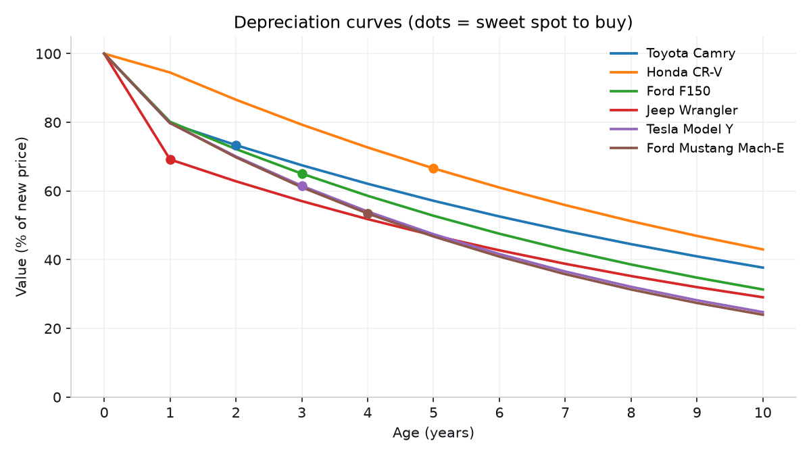
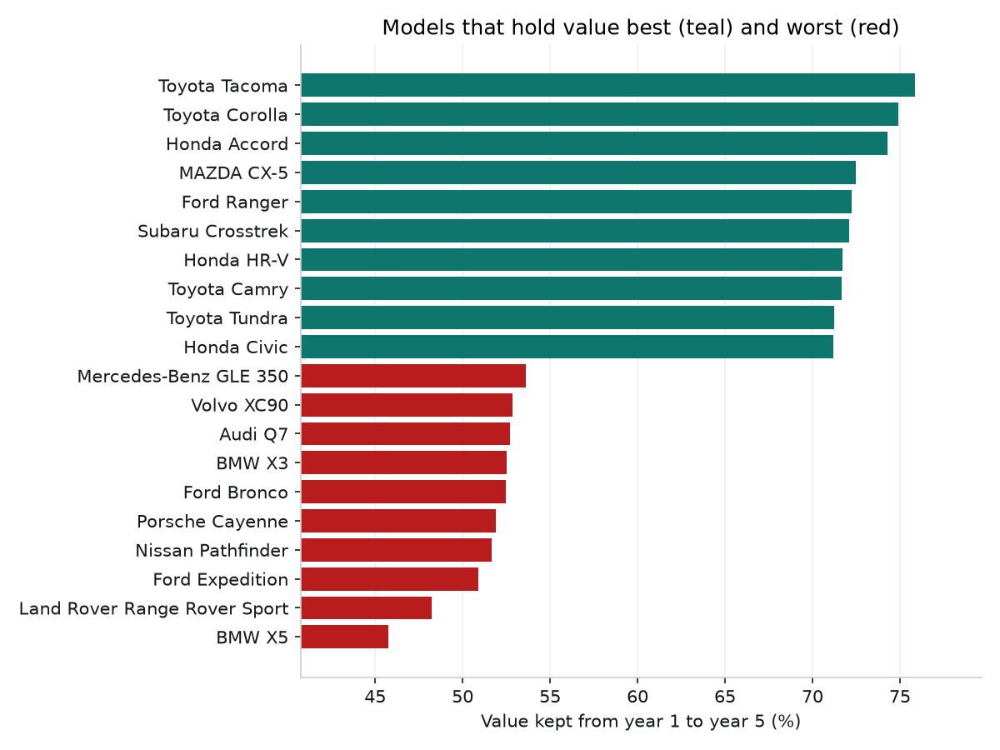
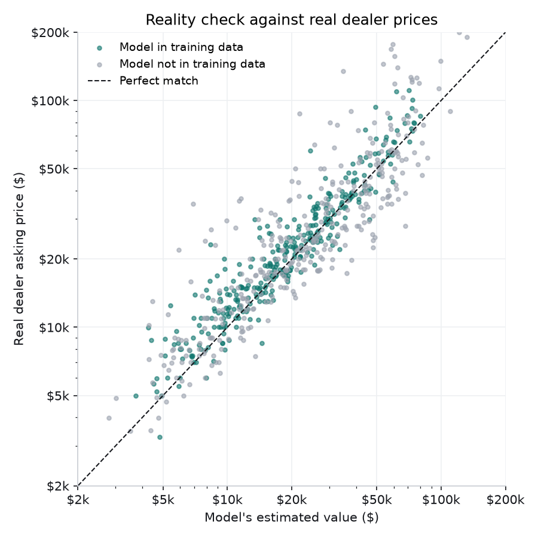

# Car Depreciation Analyzer

**When is the smartest time to buy a used car?**

Sites like AutoTrader tell you whether *one listing* is a fair price. They don't tell you
*which car* holds its value, or *how old* a car should be before you buy it. This project
treats cars like assets that lose value: it trains a machine learning model on
**16,000+ used-car listings** to estimate depreciation curves for each model, find the
"sweet spot" age to buy, and rank which cars hold their value best.

It runs as a **terminal pipeline**: download, clean, train, analyze. Plus a small
command-line tool to look up any car.

## Key findings

- **The first year is the most expensive.** A 1-year-old car is worth about **80%** of
  its new price on average, so roughly 20% disappears in year one.
- **Buying at the sweet spot cut the yearly cost of ownership roughly in half** for 5 of
  the 6 example models. For a
  Toyota Camry kept 3 years, you'd lose about $4,500/year buying new vs. about
  $2,200/year buying it 2 years old.
- **Toyota and Honda hold value best.** Tacoma, Corolla and Accord keep about 75% of
  their value from year 1 to year 5. **Luxury SUVs lose the most**: a BMW X5 keeps 46%.
- **Electric cars depreciate a bit faster than gas cars** (60% vs. 62% kept from year 1
  to 5). Only 14 electric models had enough data, so this one is a weaker signal.





Full results with all charts: [reports/findings.md](reports/findings.md)

## The model

A **gradient boosting** model (scikit-learn `HistGradientBoostingRegressor`) predicts a
car's market value from its make, model, body style, drivetrain, fuel type, age and mileage.
Tested on 3,294 cars it never saw during training:

| Model | Avg error | Median error | R² |
|---|---|---|---|
| Median guess (baseline) | $13,862 | 38.4% | -0.05 |
| Linear regression (baseline) | $4,371 | 9.9% | 0.84 |
| **Gradient boosting** | **$3,532** | **7.7%** | **0.89** |

Design choices:
- **Predicts log(value)** so errors are measured as percentages, not dollars. A $2,000
  miss matters more on a $10,000 car than on an $80,000 one.
- **Monotonic constraints:** value can only go *down* as age and mileage go up. Without
  this, noise could make a 6-year-old car "worth more" than a 5-year-old one.
- **Smoothed curves:** each model's predictions are fit with a constant-percentage
  decline, so random bumps don't decide the sweet spot.

**What matters most** (how much accuracy drops when a column is shuffled): the specific
model matters most, then age and mileage, with make, drivetrain, body and fuel much smaller.

### Reality check on a second dataset

The model was also tested against **real dealer asking prices** from a separate source
(Marketcheck). Dealers asked a median of **10% above** the model's market value, which
is expected since asking prices are a starting point for negotiation.



## How the "sweet spot" is defined

The sweet spot is the **first age at which a car starts losing value more slowly than its
10-year average.** Before that point you're paying for the steep early drop (including
"driving off the lot"). After it, depreciation has calmed down.

## Try it

```bash
python -m src.predict Toyota RAV4
```
```
Toyota RAV4  (SUV, AWD/4WD, Gas)
Based on 244 listings, 10,293 miles/year

 Age     Miles      Value  % of new  Lost that year
   0         0  $  50,414      100%
   1    10,293  $  40,233       80%         $10,181
   2    20,585  $  36,646       73%          $3,587  <- sweet spot
   3    30,878  $  33,379       66%          $3,267
   ...
Keeping it 3 years, average value lost per year:
  Buy new:            $5,678/yr
  Buy 2 years old:    $2,984/yr  (saves $2,694/yr)
```

Options: `--hold 5` (years you'll keep it), `--miles 15000` (miles you drive per year).

## Run the pipeline

```bash
python3 -m venv .venv
source .venv/bin/activate
pip install -r requirements.txt

python -m src.download   # 1. get the data (~29 MB)
python -m src.clean      # 2. clean and standardize it
python -m src.train      # 3. train the model, print accuracy
python -m src.analyze    # 4. depreciation analysis, charts, findings.md
pytest                   # tests
```

## Project structure

```
src/
  config.py        File paths and data sources
  download.py      Step 1: download raw data
  clean.py         Step 2: clean and match labels across both datasets
  features.py      Model inputs and the gradient boosting setup
  train.py         Step 3: train, compare against baselines, measure accuracy
  depreciation.py  Value curves, sweet spot and cost-of-ownership math
  analyze.py       Step 4: rankings, charts and the findings report
  predict.py       Command-line tool for one car
tests/             Tests for the cleaning rules and depreciation math
reports/           Charts, findings and accuracy metrics (generated)
```

## Data

- **AutoTrader listings** (Sept 2026), free sample from
  [Rebrowser on Hugging Face](https://huggingface.co/datasets/rebrowser/autotrader-dataset),
  CC BY-NC 4.0. The free sample hides listing prices, so a car's value is the midpoint of
  its **Kelley Blue Book fair price range**. New-car MSRPs come from the new listings.
- **Marketcheck dealer listings**
  ([Hugging Face](https://huggingface.co/datasets/Marketcheck/us_used_car_inventory_data)),
  used only for the reality check.

## Limitations

- **One snapshot in time.** The curves compare *different* cars of different ages listed
  in the same month, not the same car followed over 10 years.
- **New prices are today's prices.** A 2018 car cost less new than a 2026 one, so
  long-term depreciation is somewhat overstated. Models with no new listings get an
  estimated new price based on the typical 20% first-year drop.
- **No trim level.** A base Camry and a top-trim Camry are treated the same, which is a
  big source of the remaining error. Adding trim is the next improvement.
- **US data.** The pipeline is built so a different market (for example Ontario
  listings) could be swapped in through `download.py` and `clean.py`.
