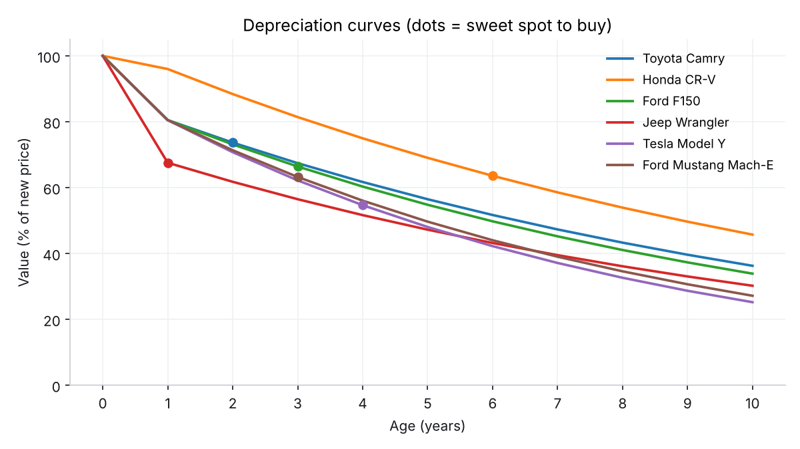
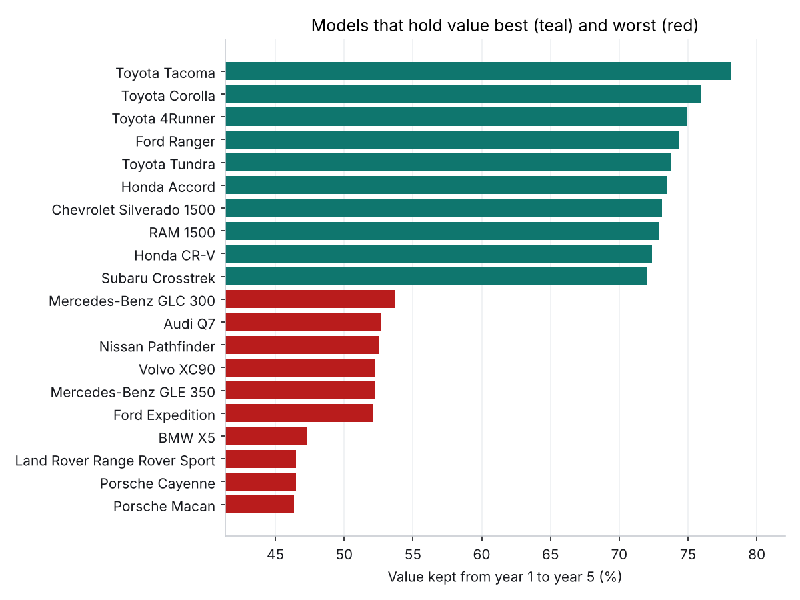
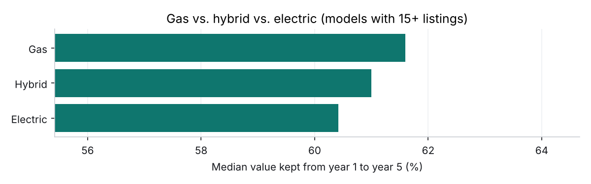

# Findings

_Generated by `python -m src.analyze`._

- Listings analyzed: **16,469** used cars; typical driving **10,293 miles/year**.
- A nearly-new used car is worth **80%** of MSRP on average: about **20%** is lost in the first year.

## Depreciation and the sweet spot

| Car | New price | Sweet spot | Value at 5 yrs | Cost/yr buying new* | Cost/yr at sweet spot* |
|---|---|---|---|---|---|
| Toyota Camry | $40,292 | 2 yrs | 56% | $4,375 | $2,309 |
| Honda CR-V | $38,750 | 6 yrs | 69% | $2,401 | $1,799 |
| Ford F150 | $62,228 | 3 yrs | 55% | $6,967 | $3,452 |
| Jeep Wrangler | $54,905 | 1 yr | 47% | $7,964 | $2,909 |
| Tesla Model Y | $56,401 | 4 yrs | 48% | $7,108 | $3,298 |
| Ford Mustang Mach-E | $46,629 | 3 yrs | 50% | $5,715 | $2,985 |

_*Average value lost per year when keeping the car for 3 years._

## Models that hold value best and worst (models with 40+ listings)

| Best | Kept yr 1-5 | Worst | Kept yr 1-5 |
|---|---|---|---|
| Toyota Tacoma | 78% | Porsche Cayenne | 46% |
| Toyota Corolla | 75% | BMW X5 | 47% |
| Toyota 4Runner | 75% | Land Rover Range Rover Sport | 48% |
| Ford Ranger | 74% | Porsche Macan | 52% |
| Toyota Tundra | 74% | Volvo XC90 | 52% |
| Honda Accord | 74% | Mercedes-Benz GLE 350 | 52% |
| RAM 1500 | 73% | Nissan Pathfinder | 53% |
| Subaru Crosstrek | 72% | Audi Q7 | 53% |
| Chevrolet Silverado 1500 | 72% | Ford Expedition | 53% |
| Honda CR-V | 72% | Mercedes-Benz GLC 300 | 54% |

## Brands, fuel types and body styles

| Fuel type | Median value kept yr 1-5 | Models |
|---|---|---|
| Gas | 62% | 200 |
| Hybrid | 61% | 5 |
| Electric | 60% | 14 |

## Reality check: real dealer prices

Tested on **672** cars from a different source (Marketcheck dealer listings). For the **327** whose model was in the training data:

- Median dealer price / model estimate: **1.10** (1.00 would be a perfect match; above 1 means dealers ask more than market value)
- **54%** of estimates were within 15% of the real asking price

