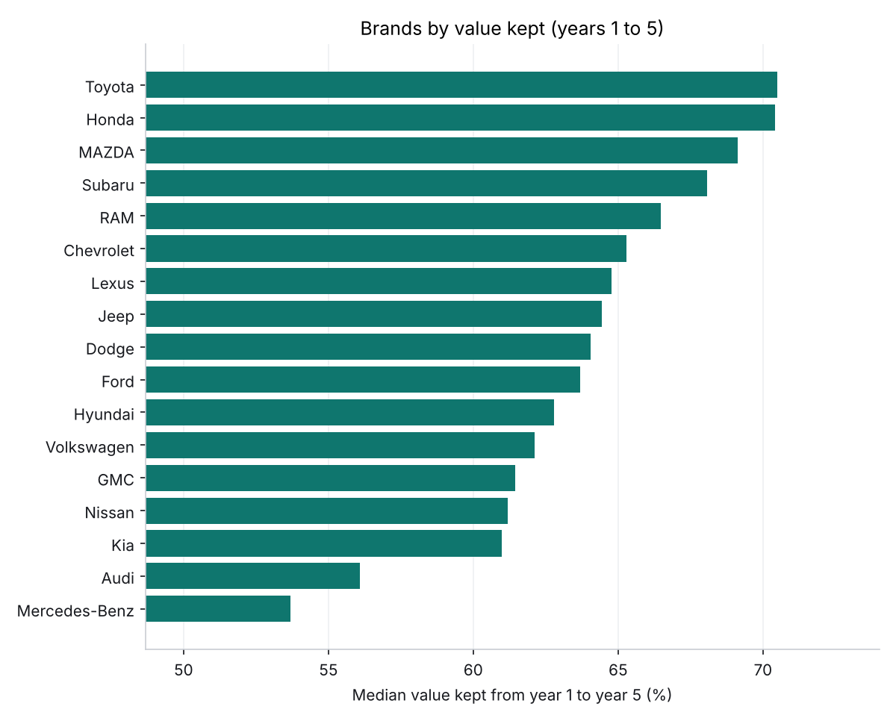
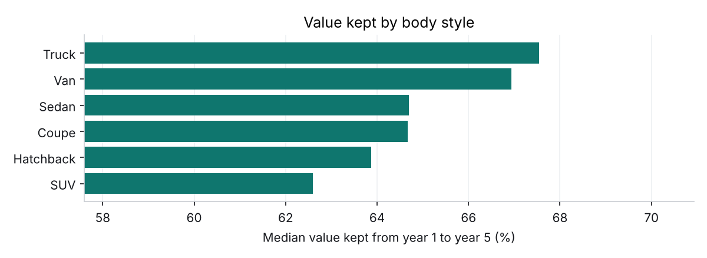
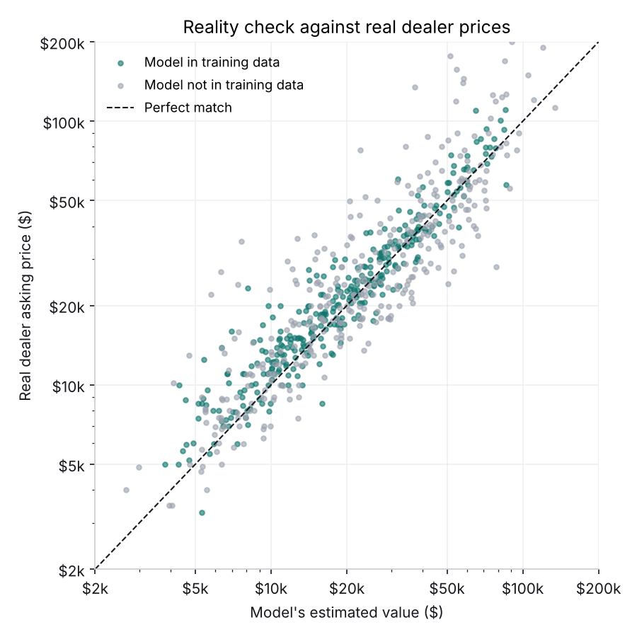

# Findings

_Generated by `python -m src.analyze`._

- Listings analyzed: **16,469** used cars; typical driving **10,293 miles/year**.
- A nearly-new used car is worth **80%** of MSRP on average: about **20%** is lost in the first year.

## Depreciation and the sweet spot

| Car | New price | Sweet spot | Value at 5 yrs | Cost/yr buying new* | Cost/yr at sweet spot* |
|---|---|---|---|---|---|
| Toyota Camry | $40,717 | 2 yrs | 56% | $4,487 | $2,355 |
| Honda CR-V | $38,750 | 6 yrs | 69% | $2,383 | $1,778 |
| Ford F150 | $62,050 | 2 yrs | 55% | $6,948 | $3,712 |
| Jeep Wrangler | $54,905 | 1 yr | 47% | $7,950 | $2,900 |
| Tesla Model Y | $55,892 | 3 yrs | 49% | $7,013 | $3,647 |
| Ford Mustang Mach-E | $47,616 | 3 yrs | 49% | $5,953 | $3,092 |

_*Average value lost per year when keeping the car for 3 years._

## Models that hold value best and worst (models with 40+ listings)

| Best | Kept yr 1-5 | Worst | Kept yr 1-5 |
|---|---|---|---|
| Toyota Tacoma | 78% | Porsche Macan | 46% |
| Toyota Corolla | 76% | Porsche Cayenne | 46% |
| Toyota 4Runner | 75% | Land Rover Range Rover Sport | 47% |
| Ford Ranger | 74% | BMW X5 | 47% |
| Toyota Tundra | 74% | Ford Expedition | 52% |
| Honda Accord | 73% | Mercedes-Benz GLE 350 | 52% |
| Chevrolet Silverado 1500 | 73% | Volvo XC90 | 52% |
| RAM 1500 | 73% | Nissan Pathfinder | 53% |
| Honda CR-V | 72% | Audi Q7 | 53% |
| Subaru Crosstrek | 72% | Mercedes-Benz GLC 300 | 54% |

## Brands, fuel types and body styles

| Fuel type | Median value kept yr 1-5 | Models |
|---|---|---|
| Gas | 62% | 200 |
| Hybrid | 61% | 5 |
| Electric | 61% | 14 |

## Reality check: real dealer prices

Tested on **672** cars from a different source (Marketcheck dealer listings). For the **327** whose model was in the training data:

- Median dealer price / model estimate: **1.10** (1.00 would be a perfect match; above 1 means dealers ask more than market value)
- **55%** of estimates were within 15% of the real asking price

