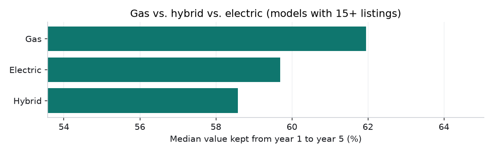
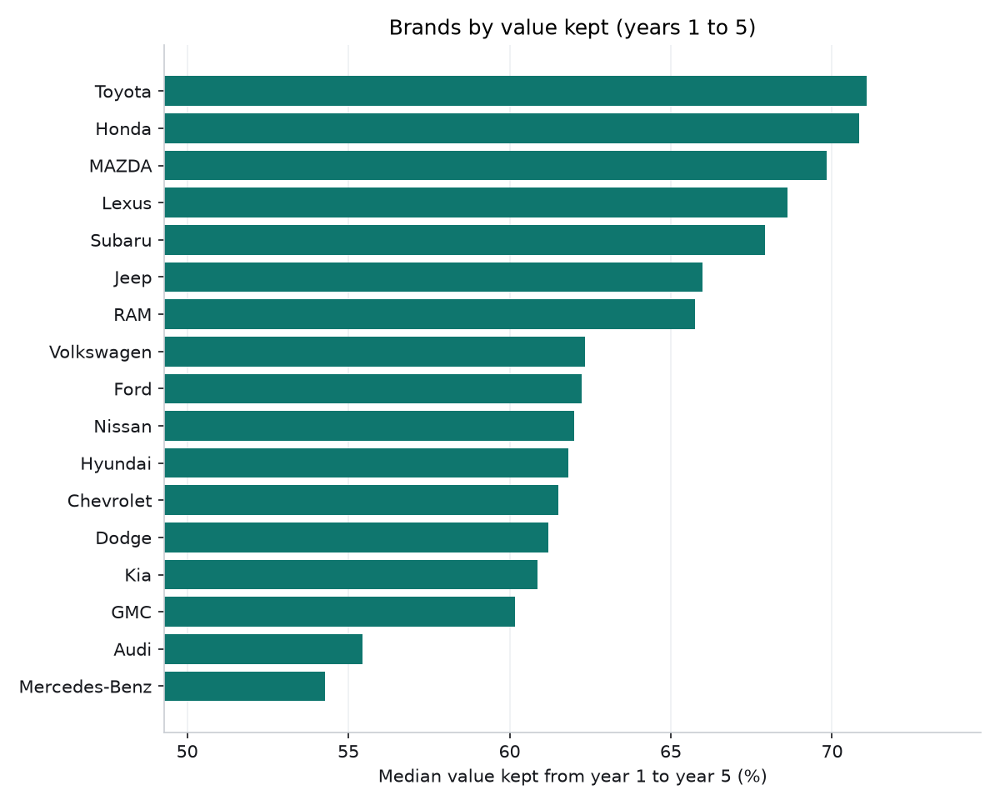
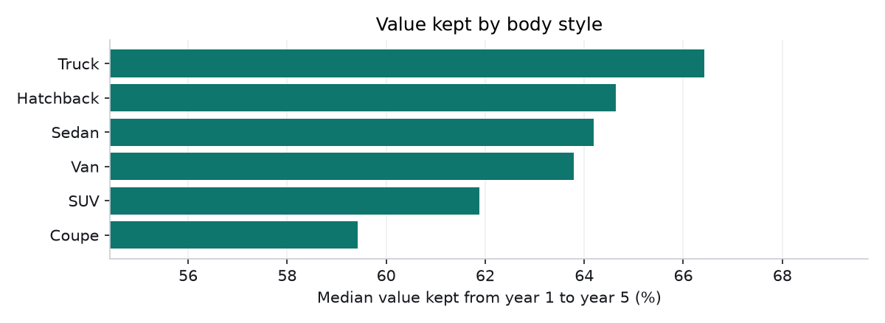

# Findings

_Generated by `python -m src.analyze`._

- Listings analyzed: **16,469** used cars; typical driving **10,293 miles/year**.
- A nearly-new used car is worth **80%** of MSRP on average: about **20%** is lost in the first year.

## Depreciation and the sweet spot

| Car | New price | Sweet spot | Value at 5 yrs | Cost/yr buying new* | Cost/yr at sweet spot* |
|---|---|---|---|---|---|
| Toyota Camry | $41,217 | 2 yrs | 57% | $4,464 | $2,227 |
| Honda CR-V | $38,750 | 5 yrs | 67% | $2,670 | $1,986 |
| Ford F150 | $73,920 | 3 yrs | 53% | $8,610 | $4,310 |
| Jeep Wrangler | $58,890 | 1 yr | 47% | $8,429 | $3,411 |
| Tesla Model Y | $58,713 | 3 yrs | 47% | $7,531 | $3,891 |
| Ford Mustang Mach-E | $48,549 | 4 yrs | 47% | $6,298 | $2,857 |

_*Average value lost per year when keeping the car for 3 years._

## Models that hold value best and worst (models with 40+ listings)

| Best | Kept yr 1-5 | Worst | Kept yr 1-5 |
|---|---|---|---|
| Toyota Tacoma | 76% | BMW X5 | 46% |
| Toyota Corolla | 75% | Land Rover Range Rover Sport | 48% |
| Honda Accord | 74% | Ford Expedition | 51% |
| MAZDA CX-5 | 72% | Nissan Pathfinder | 52% |
| Ford Ranger | 72% | Porsche Cayenne | 52% |
| Subaru Crosstrek | 72% | Ford Bronco | 52% |
| Honda HR-V | 72% | BMW X3 | 53% |
| Toyota Camry | 72% | Audi Q7 | 53% |
| Toyota Tundra | 71% | Volvo XC90 | 53% |
| Honda Civic | 71% | Mercedes-Benz GLE 350 | 54% |

## Brands, fuel types and body styles

| Fuel type | Median value kept yr 1-5 | Models |
|---|---|---|
| Gas | 62% | 201 |
| Electric | 60% | 14 |
| Hybrid | 59% | 4 |

## Reality check: real dealer prices

Tested on **672** cars from a different source (Marketcheck dealer listings). For the **327** whose model was in the training data:

- Median dealer price / model estimate: **1.10** (1.00 would be a perfect match; above 1 means dealers ask more than market value)
- **52%** of estimates were within 15% of the real asking price

